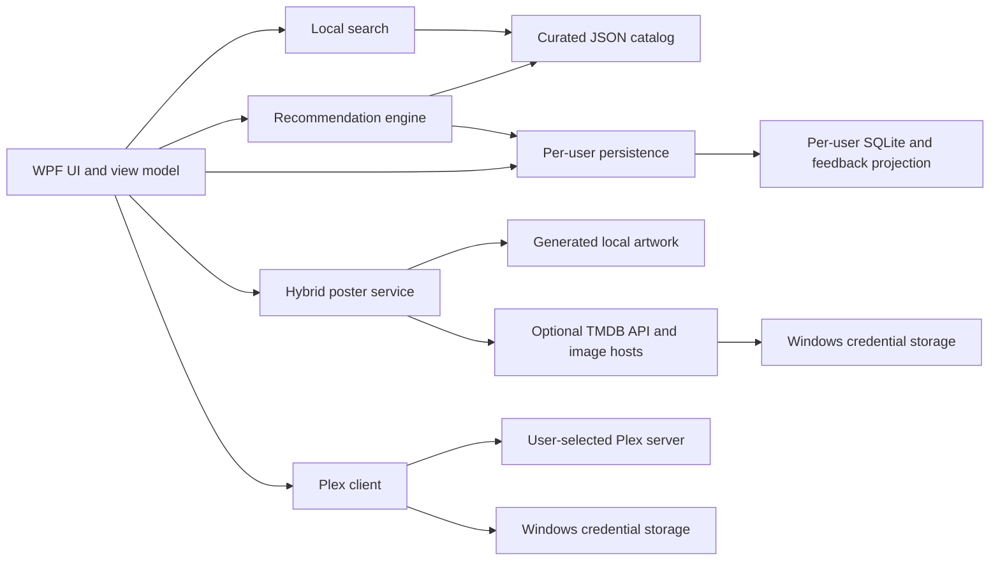

# HorrorHarbor implementation architecture

**Status:** As-built public-source architecture
**Scope:** Local discovery, optional provider integrations, per-user data, and
Windows delivery

## Privacy boundary

HorrorHarbor ships one curated JSON recommendation catalog and no personal
watch-history database. A new installation starts with an empty taste history.
Search and ranking run locally. Personalization is derived only from the current
user's explicit feedback, mood controls, and optional Plex import.

User data is stored beneath `%LOCALAPPDATA%`; provider secrets are stored through
Windows credential abstractions. User databases, credentials, caches, logs, and
official-provider images are not distributable application assets.

## Component flow

## Project responsibilities

| Project | Responsibility |
|---|---|
| Core | Provider-neutral contracts and immutable models |
| Search | Query parsing, indexing, retrieval, deterministic ranking, and evidence |
| Recommendations | Taste-profile construction and explainable recommendation ranking |
| Data | Strict catalog loading, per-user persistence, feedback, and hardened Plex integration |
| Posters | Generated artwork, optional TMDB retrieval, provenance, and bounded caches |
| App | WPF composition, interaction, accessibility, and safe user-facing errors |
| Tools | Performance, self-test, and poster-audit executables |
| Tests | Unit, integration, security, and deterministic acceptance coverage |

## Network boundaries

Ordinary launch, search, ranking, feedback, and generated artwork require no
network connection.

- Plex is contacted only after the user supplies a server and token and starts
  a connection or sync action. HTTPS is the default. Plain HTTP requires
  explicit opt-in and a private, link-local, or loopback IP literal. Redirects
  are disabled, the token is header-only, and XML/time/retry/item bounds apply.
- TMDB is contacted only after the user acknowledges the provider terms and
  saves an authorized credential. Bearer authorization is restricted to
  `api.themoviedb.org`; image requests to `image.tmdb.org` do not receive it.
  Official image bytes remain per-user cache data.

## Storage boundaries

| Data | Location | Distribution rule |
|---|---|---|
| Curated catalog | Installed `data/catalog/recommendation_catalog.json` | Included |
| User database | `%LOCALAPPDATA%\HorrorHarbor\user-data.db` | Never included |
| Feedback projection | `%LOCALAPPDATA%\HorrorHarbor\recommendation_feedback.json` | Never included |
| Diagnostics | `%LOCALAPPDATA%\HorrorHarbor\logs` | Never included |
| Generated posters | `%LOCALAPPDATA%\NocturneHarbor\posters-v1` | Never included as user cache |
| Official posters | `%LOCALAPPDATA%\NocturneHarbor\official-posters-v1` | Never included |
| Provider credentials | Windows Credential Manager or documented current-user fallback | Never included |

The SQLite user database is not encrypted. Windows profile permissions are the
primary local boundary; another process running as the same user can read it.

## Release boundary

The publish payload must be produced from a clean restore and staging directory.
It may contain application binaries, framework/runtime files, the curated
catalog, and intentional static UI assets only. A release gate must reject
databases, credentials, provider caches, logs, local paths, unexpected generated
artifacts, and secret-like content.

Unsigned executables and installers are development artifacts. Public binary
promotion additionally requires final inventory, checksums, malware scanning,
publisher-controlled Authenticode signing with timestamping, and clean-machine
verification. See `SECURITY.md`, `PRIVACY.md`, and `installer/README.md`.
